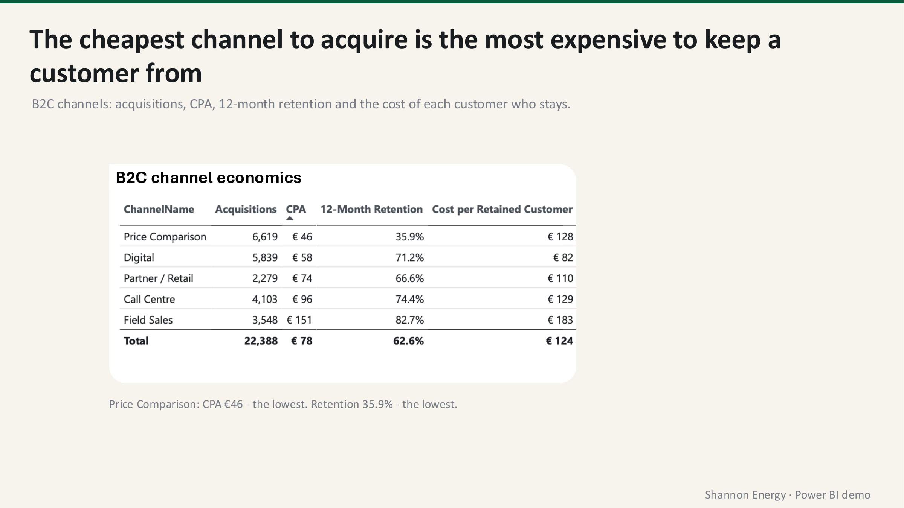
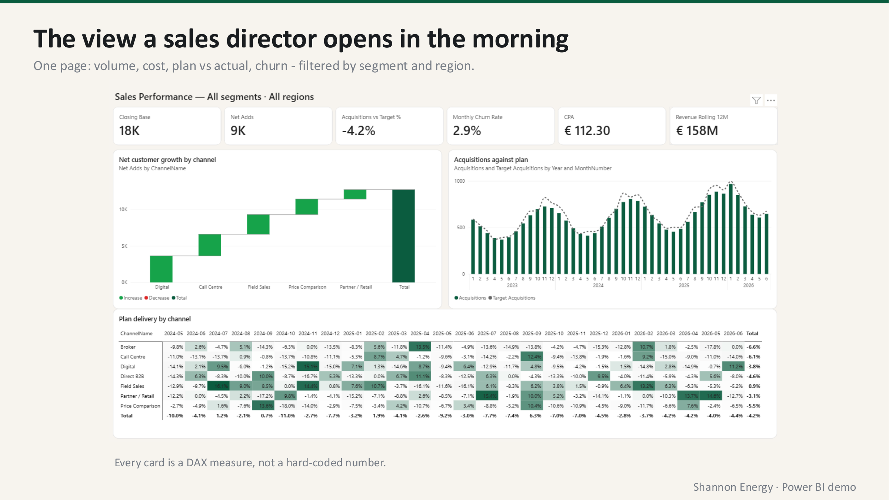
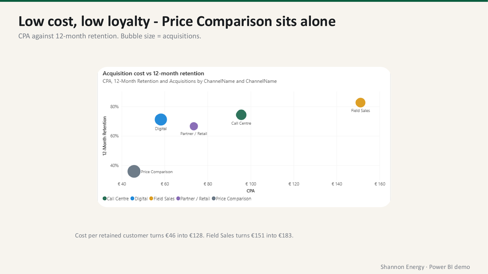
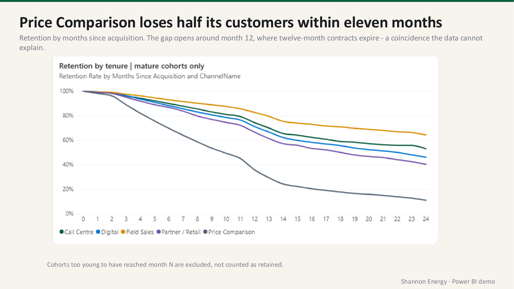
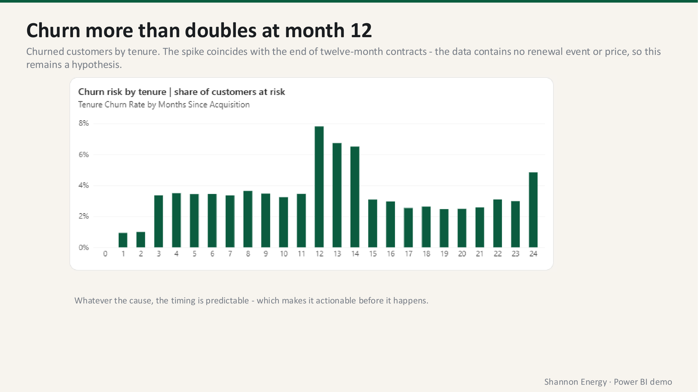
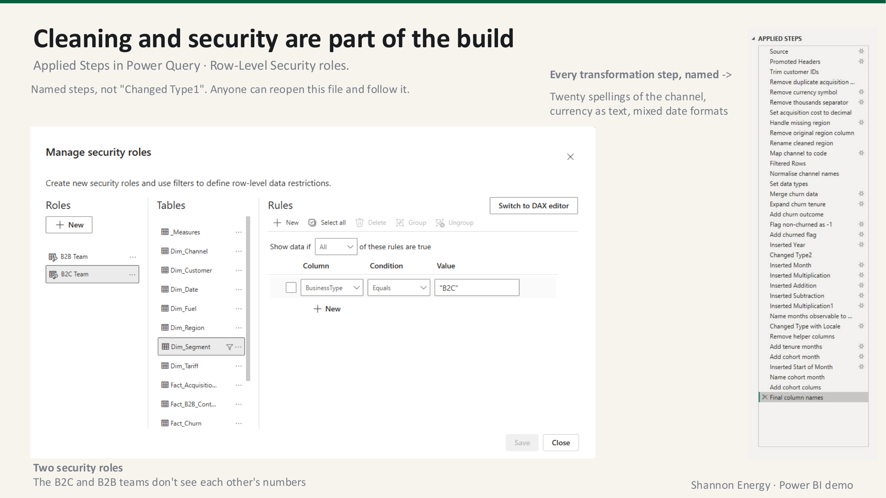

# Shannon Energy - Sales & Retention Analytics in Power BI

An end-to-end Power BI build for a fictional Irish energy retailer: raw CSV files cleaned
in Power Query, modelled into a star schema, measured with 29 DAX measures, secured with
row-level security, and presented as a report a sales director could open every morning.

26,000 acquisitions · 17,000 churn events · 5 B2C channels · 2023–2026

---

## The headline finding

**The cheapest channel to acquire from is the most expensive to keep a customer from.**

Price Comparison has the lowest cost per acquisition in the business at €46. On a CPA
league table it wins outright. But only 35.9% of its customers are still there twelve
months later - the worst retention of any channel.

Once churn is priced in, each *surviving* Price Comparison customer costs **€128**.
Digital, whose CPA is 26% higher at €58, delivers a retained customer for **€82**.

Ranking channels on acquisition cost alone points the budget at the worst-performing
source of customers in the portfolio.



---

## Business problem

Shannon Energy is growing its base but missing its acquisition plan, and the existing
reporting cannot answer three questions:

1. Which channels create value once the customers who leave are accounted for?
2. When do customers churn, and is the risk spread evenly across tenure?
3. Where is the shortfall against plan concentrated?

---

## The report

### Sales performance - the one-page view

Closing base, net adds, plan achievement, monthly churn, CPA and rolling 12-month revenue,
with net growth by channel, acquisitions against plan, and plan delivery by channel and
month. Every card is a DAX measure, not a hard-coded number.



### Cost against loyalty

CPA plotted against twelve-month retention, bubble size by acquisitions. Price Comparison
sits alone in the bottom-left corner: cheap to buy, quick to leave.



### Retention curves by channel



### Churn risk by tenure



---

## Key findings

Findings are labelled by how strongly the data supports them.

### FACT - directly supported by the data

| Channel | Acquisitions | CPA | 12-month retention | Cost per retained customer |
|---|---:|---:|---:|---:|
| Price Comparison | 6,619 | €46 | 35.9% | €128 |
| Digital | 5,839 | €58 | 71.2% | **€82** |
| Partner / Retail | 2,279 | €74 | 66.6% | €110 |
| Call Centre | 4,103 | €96 | 74.4% | €129 |
| Field Sales | 3,548 | €151 | 82.7% | €183 |
| **Total** | **22,388** | **€78** | **62.6%** | **€124** |

- **Digital is the most efficient channel** on cost per retained customer, not the channel
  with the lowest CPA.
- **Ranking by CPA and by cost per retained customer disagree.** Price Comparison moves
  from first to fourth of five once retention is applied.
- **Churn risk is not flat across tenure.** It sits near 3.4% for most months, then rises
  to 7.8% at month 12 - more than double - before falling back.
- **Price Comparison loses half its customers within eleven months**, and is down to
  roughly 11% by month 24. No other channel falls below 40%.
- Blended monthly churn is **2.9%**; acquisitions are **4.2% behind plan**; rolling
  12-month revenue is **€158M**.

### INFERENCE - a reasonable reading of the data

Retention rises as CPA rises across four of the five channels, which is consistent with
higher-touch channels selecting for less price-sensitive customers. The exception is
Partner / Retail.

### HYPOTHESIS - requires further investigation

The churn spike at month 12 **coincides with** the expiry of twelve-month contracts. This
is a plausible explanation, **not a demonstrated cause** - the data contains no renewal
event, no price change at renewal and no competitor pricing.

---

## Recommendations

1. **Move acquisition budget from Price Comparison to Digital.** Digital delivers a
   retained customer for €82 against €128 - 36% less.
2. **Intervene at month 10, not month 13.** Churn risk more than doubles at month 12, and
   the timing is predictable in advance.
3. **Treat Price Comparison as a volume channel, not a growth channel.** It brings the most
   customers and keeps the fewest.
4. **Capture renewal offers and outcomes.** Without them the month-12 pattern stays a
   hypothesis.

---

## Built in Power Query and DAX



### Cleaning is part of the build, not a preliminary

Every transformation step in Power Query is **named** - `Map channel to code`,
`Handle missing region`, `Add churn outcome` - rather than left as `Changed Type1`. Anyone
can reopen the file and follow what was done and why.

The source data needed it: twenty different spellings of the channel names, acquisition
cost stored as text with currency symbols, and churn dates in mixed formats.

### Row-level security

Two roles are defined on the model. The B2C and B2B teams see only their own figures,
filtered on `BusinessType` at the `Dim_Segment` table. Security is part of the model
design, not something bolted on at publication.

### Measures that fail honestly

Retention is calculated on **mature cohorts only**. A cohort acquired three months before
the cut-off cannot yet have a twelve-month outcome, so it is excluded from the denominator
rather than counted as churned - which would bias retention downward.

Where a cohort has not yet reached month N, the measure returns **BLANK**, not zero. In the
cohort matrix those blanks are visible as empty cells. A blank is an honest gap in the data;
filling it with 100% is the classic error.

29 DAX measures in total, over a star schema of five fact tables and six dimensions.

---

## Limitations

Stated explicitly, because a report that hides them is a report that misleads.

- **No profitability analysis.** The source data contains no cost of goods, so margin and
  contribution cannot be calculated. An earlier draft of this project included a
  contribution metric based on an assumed 18% margin; it was removed rather than published
  on an assumption.
- **No causal claims.** The analysis identifies when churn happens, not why.
- **No competitor pricing.** Switching reasons are self-reported, and 40% of churn events
  have no destination recorded at all.
- **No forecasting.** Future periods contain no actuals.
- **Fixed cut-off of 30 June 2026**, so the figures remain reproducible.

---

## Companion project

The same raw data is analysed in Tableau in
**[shannon-energy-tableau](https://github.com/marinakulman/shannon-energy-tableau)**, where
the cleaning is done in a reproducible Python pipeline instead of Power Query, and the
source data and metric dictionary are published in full.

The two projects were built independently and arrive at the same figures - €46 CPA against
35.9% retention for Price Comparison, €128 per retained customer, 2.9% monthly churn.
Reproducing a result by a second route is how the method was checked.

---

## Files

```
shannon-energy-powerbi/
├── images/           report screenshots
└── presentation/     the full project presentation (PDF)
```

The Power BI workbook itself is not published here. The report pages, the model approach
and the measure logic are documented above and in the presentation.

---

## Data

Synthetic demonstration data. It contains no real customers and no personal information.
The company, its customers and the competitors named in the churn data are fictional.

## Author

**Marina Kulman** - Data & BI Analyst, Dublin
[Portfolio](https://marinakulman.github.io/Portfolio/) · [GitHub](https://github.com/marinakulman)
